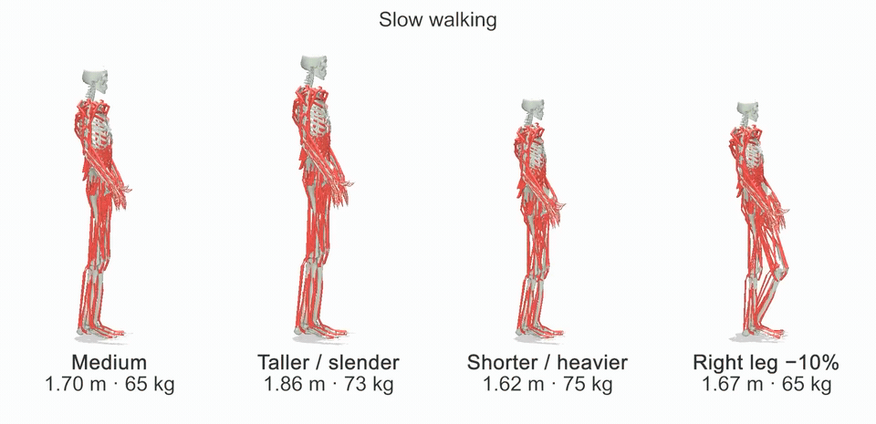
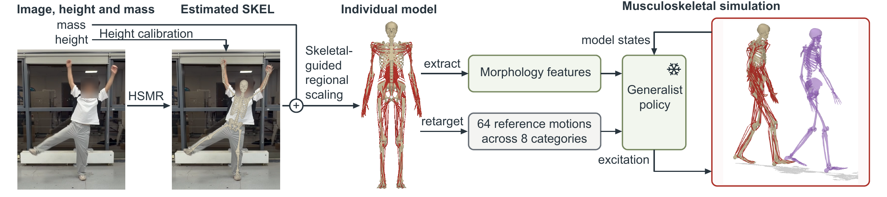
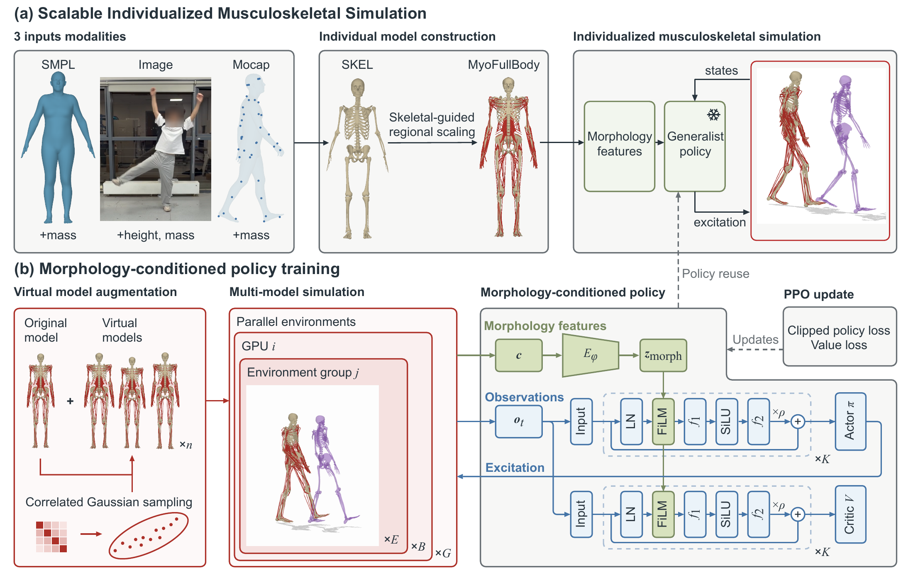

# MyoAcross

**A Framework for Scalable Individualized Musculoskeletal Simulation with a Generalist Morphology-Conditioned Policy**

**[Project Page](https://woodater-thu.github.io/MyoAcross/) · [Paper](https://arxiv.org/abs/2610.36535) · [Checkpoints](https://huggingface.co/woodater/myoacross-checkpoints)**

<p align="center">
  <a href="https://woodater-thu.github.io/MyoAcross/">
    
  </a>
</p>

## ✨ Highlights

**MyoAcross** connects accessible model construction with a generalist policy for scalable individualized musculoskeletal simulation.

- **One policy, many bodies.** Achieves **99.24% completion** across 31 held-out models, compared with **8.32%** for a policy trained only on the generic model, with a mean tracking error of **53.70 mm**.
- **Three ways to build the model.** Constructs 416-muscle full-body models from SMPL body shape, monocular images, or marker-based motion capture. All pathways use measured body mass; monocular images additionally require height.
- **Beyond motion tracking.** On **120 Gait120 subjects**, regionally scaled models improve agreement with measured vertical ground reaction forces and surface electromyography (sEMG) over generic and globally scaled models.
- **Generalization across inputs and asymmetric models.** The pretrained policy achieves **99.29% completion** on image-derived models. Asymmetry augmentation extends reuse to up to **10% unilateral lower-limb shortening**.

## 📸 Try it on an image-derived model

**From a photograph to muscle-driven movement.** The example below shows how a monocular image, height, and body mass connect to individualized simulation.

<p align="center">
  
</p>

The runnable demo uses the model already constructed from this photograph. It retargets one AMASS walking motion and opens a window showing the pretrained generalist policy driving the model without fine-tuning. It does not rerun image reconstruction.

### 1. Install

Run all commands from the repository root.

Use Linux and an NVIDIA GPU with a compatible driver. Follow the [installation guide](docs/install.md) to prepare the root and GMR-Fit environments and required model resources.

### 2. Download the pretrained generalist policy

Install the Hugging Face CLI if `hf` is not available:

```bash
uv tool install huggingface_hub
```

Download the standard FiLM checkpoint from [Hugging Face](https://huggingface.co/woodater/myoacross-checkpoints):

```bash
hf download woodater/myoacross-checkpoints \
  standard_v10/final.pt \
  --local-dir checkpoints
```

The checkpoint repository also provides MLP, Concat, generic-model baseline, and augmentation variants.

### 3. Run the image-derived model demo

The repository includes an anonymized example image and its prebuilt musculoskeletal model. Obtain access to the [AMASS dataset](https://amass.is.tue.mpg.de/) and prepare the resources described in the [demo instructions](docs/experiments.md#licensed-kit-motions-for-the-single-image-demo), then run:

```bash
.venv/bin/python -m myoacross.utils.image2msksim.prepare_single_image_demo \
  --checkpoint checkpoints/standard_v10/final.pt
```

The script obtains the KIT archive using your AMASS account if needed, prepares one walking motion, and opens the policy viewer. Close the window to finish. Reference motions are not bundled with the release. Outputs go to `data/experiments/single_image_demo/`.

Add `--headless` to evaluate the walking clip without a window. Add `--evaluate --headless` for all 64 reference motions.

## ⚙️ How MyoAcross works

Construct an individual model, condition a generalist policy on its morphology, and simulate movement without fine-tuning.

Skeletal-guided regional scaling and mass calibration preserve body proportions and mass. Morphology conditioning and virtual model augmentation support policy reuse across individuals. The framework includes MLP, Concat, and FiLM policy variants.

<p align="center">
  
</p>

## 🚀 Training and Evaluation

MyoAcross supports model construction, motion retargeting, multi-GPU policy training, and parallel evaluation.

| Task | Documentation |
| --- | --- |
| Prepare datasets and model resources | [Installation](docs/install.md) · [Datasets](docs/dataset.md) |
| Construct models and retarget motions | [Model construction](docs/embodiment.md) · [Retargeting](docs/retarget.md) |
| Train, evaluate, and replay policies | [Reinforcement learning](docs/rl.md) |
| Follow the paper’s experimental protocols | [Paper experiments](docs/experiments.md) |

## 📖 Citation

If you use MyoAcross in your research, please cite:

```bibtex
@misc{wang2026myoacross,
  title = {A generalist policy for muscle-driven control across individual musculoskeletal models},
  author = {Wang, Bozhao and Zhu, Yinglei and Li, Zhengqing and Zhang, Zhiyuan and Kang, Weiming and He, Yiheng and Liu, Xinjun and Hou, Senhao and Zhao, Huichan and Tang, Xiaoqiang},
  year = {2026},
  eprint = {2610.36535},
  archivePrefix = {arXiv},
  primaryClass = {cs.RO},
  url = {https://arxiv.org/abs/2610.36535}
}
```

## 📜 License and Acknowledgments

Code is released under [Apache-2.0](LICENSE). Pretrained checkpoints use the license specified in the [Hugging Face model card](https://huggingface.co/woodater/myoacross-checkpoints). Third-party code, body models, and datasets retain their respective licenses.

MyoAcross builds on MyoSuite, MuscleMimic models, SKEL, SMPL, GMR-Fit, HSMR, mjlab, and RSL-RL. We thank their authors for making these resources available.
